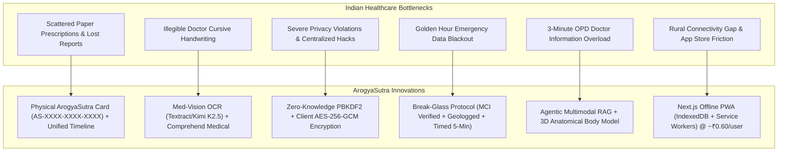
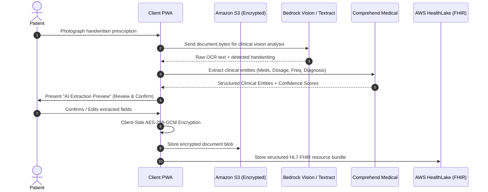

# ArogyaSutra: Problem-Solution Architecture & Impact Analysis

> **Executive Summary:** ArogyaSutra is an AI-powered, Zero-Knowledge Encrypted Personal Health Record (PHR) ecosystem engineered specifically for India's fragmented, paper-heavy healthcare landscape. It replaces crumpled paper files, unreadable handwritten prescriptions, and isolated hospital records with a patient-owned, cryptographically sovereign, FHIR-compliant digital health timeline unlocked by a physical card (`AS-XXXX-XXXX-XXXX`).

---

## 1. System Context & Overview

In India, healthcare delivery is predominantly out-of-pocket, decentralized, and paper-based. Over 1.4 billion citizens interact with an ecosystem of private clinics, municipal hospitals, corporate hospital chains (e.g., Apollo, Manipal, Fortis), and independent diagnostic labs (e.g., Metropolis, Dr Lal PathLabs).

While the Indian Government has initiated the **Ayushman Bharat Digital Mission (ABDM)**, the ground reality remains characterized by:
- Physical document loss and decay.
- Illegible doctor handwriting.
- Zero data portability across disparate hospital systems.
- Complete data blackout during emergency ("Golden Hour") scenarios.
- Extreme data privacy vulnerabilities where patients do not own their medical information.

**ArogyaSutra** solves these exact systemic bottlenecks through a client-heavy architecture combining **Client-Side Zero-Knowledge Cryptography (Web Crypto AES-256-GCM)**, **Physical Card Identity**, **AI-Powered Clinical Vision & NLP**, **Multimodal Agentic RAG**, and **3D Anatomical Spatial Mapping**.

---

## 2. The Exact Problems ArogyaSutra Solves

### Problem 1: The "Plastic Bag" Paradigm & Lost Medical Records
* **The Clinical & Real-World Reality:** In India, patients typically carry plastic bags or accordion folders filled with physical papers: prescriptions from years ago, thermal receipts, blood reports, X-ray films, and discharge summaries from different hospitals.
* **The Consequences:**
  - Critical documents are lost, misplaced, torn, or left at home during doctor visits.
  - Doctors are forced to re-order expensive duplicate diagnostic tests (repeat blood tests, repeated CT/X-rays), increasing out-of-pocket healthcare expenditures.
  - Previous adverse reactions, past surgeries, or long-term medication changes are frequently omitted from patient recall.
* **How ArogyaSutra Solves It:**
  - Every patient receives a physical **ArogyaSutra Card** with a unique identifier in `AS-XXXX-XXXX-XXXX` format.
  - The card acts as the physical-digital anchor for their entire lifetime health timeline.
  - All records are cataloged chronologically with document type tags:
    - `[RX]` — Prescriptions
    - `[Lab]` — Pathology / Lab Reports
    - `[H]` — Hospitalization / Discharge Summaries
    - `[Consult]` — Outpatient Consultation Notes
    - `[Imaging]` — Scans (X-Ray, CT, MRI, Ultrasound)
    - `[Vacc]` — Immunizations
    - `[Insurance]` — Policy and Claims Records
  - Every record tracks status flags (`VERIFIED`, `AI-READ`, `CRITICAL`) and source institutions (e.g., *Apollo Hospitals*, *Metropolis Labs*).

---

### Problem 2: Illegible Doctor Handwriting & Medical Dispensing Errors
* **The Clinical & Real-World Reality:** Doctor cursive handwriting in India is notoriously difficult to decipher. Pharmacists regularly misread handwritten drug names, resulting in wrong formulations, wrong strengths, or incorrect dosing regimens (e.g., misinterpreting *OD* [once daily] as *BD* [twice daily] or *TDS* [thrice daily]).
* **How ArogyaSutra Solves It:**
  - **Med-Vision AI Engine:** Integrates a multimodal clinical pipeline designed specifically for Indian medical documentation:
    - **Amazon Textract** and **Bedrock Vision (Moonshot Kimi K2.5 / Amazon Nova Pro)** tailored with Indian medical prescription heuristics (interpreting abbreviations like *OD, BD, TDS, QID, SOS, HS, AC, PC, Tab, Cap, Inj, Syr* and detecting the *Rx (℞)* symbol).
    - **Amazon Comprehend Medical** for biomedical Named Entity Recognition (NER), extracting exact medication names, dosages, routes, frequencies, durations, lab values, and clinical diagnoses.
  - **Confidence Scoring & Human-in-the-Loop:** Displays an "AI Extraction Preview" with confidence metrics (e.g., "95% confident"). If confidence falls below 70%, the system flags the entry for patient or doctor confirmation before committing it to the encrypted vault.

---

### Problem 3: The Healthcare Data Privacy Paradox (Centralized Cloud Vulnerabilities)
* **The Systemic Vulnerability:** In traditional digital health and hospital management apps, patient records are stored in plaintext databases. Cloud administrators, support staff, rogue employees, or cyberattackers can access, leak, or monetize sensitive patient health data (HIV status, psychiatric evaluations, oncology treatments).
* **How ArogyaSutra Solves It (Zero-Knowledge Architecture):**
  - **Client-Side Key Derivation:**
    $$\text{Master\_Key} = \text{PBKDF2}(\text{Card\_ID} \parallel \text{OTP}, \text{salt}=\text{Card\_ID}, \text{iterations}=100000, \text{SHA-256})$$
  - The master key is derived ephemerally inside the user's browser using the native **Web Crypto API**.
  - **Zero Key Persistence:** The Master Key is **never stored** in `localStorage`, `sessionStorage`, `IndexedDB`, or sent to any server. It exists strictly in volatile memory during the active session.
  - **Ciphertext Storage Only:** Cloud servers (Amazon S3, AWS HealthLake, DynamoDB) store exclusively encrypted ciphertext (`AES-256-GCM`). Even ArogyaSutra core engineers and AWS infrastructure operators cannot decrypt patient records.
  - **Asymmetric Doctor Sharing:** When sharing with a doctor, the patient's client re-encrypts the session access key using the doctor's public key via **RSA-OAEP**.

---

### Problem 4: The "Golden Hour" Emergency Data Blackout
* **The Critical Medical Emergency:** During road accidents, cardiac arrests, or sudden collapses, patients are often unconscious or unresponsive. First responders and ER physicians have no immediate way to know:
  - The patient's blood group.
  - Fatal allergies (e.g., Penicillin anaphylaxis, Sulfa drugs).
  - Chronic pre-existing conditions (e.g., Type 1 Diabetes, Epilepsy, Stent implants).
  - Critical ongoing medications (e.g., Warfarin / blood thinners).
  Treating blind frequently leads to fatal anaphylactic shock or surgical hemorrhage.
* **How ArogyaSutra Solves It (Break-Glass Protocol):**
  - **Direct Landing Access:** A dedicated, prominent Emergency Break-Glass button is present right on the application welcome screen without requiring patient login or OTP.
  - **MCI Credential Verification:** The attending physician must input their verified **Medical Council of India (MCI) Registration Number** (e.g., `KA-28411`).
  - **Mandatory Geolocation Enforcement:** The device captures high-accuracy GPS coordinates (`latitude`, `longitude`, timestamp) before granting access.
  - **Critical-Only Filter:** Emergency access does *not* expose the patient's entire private medical timeline. It reveals strictly life-saving metadata:
    - Blood Group
    - Known Severe Allergies
    - Critical Active Medications
    - Active Chronic Conditions
    - Designated Emergency Contact Numbers (with one-touch dialing)
  - **Active 5-Minute Countdown & Auto-Termination:** A visible countdown timer runs (300 seconds); access is automatically revoked when the timer reaches zero.
  - **Immediate Multi-Party SMS Notification:** Amazon SNS immediately dispatches an SMS alert to both the patient's registered mobile number and their designated emergency contacts with the doctor's MCI details and time of access.
  - **Immutable DynamoDB Audit Trail:** All access logs are recorded immutably for 7 years.

---

### Problem 5: The "3-Minute OPD" Information Overload
* **The Clinical Bottleneck:** In high-volume outpatient clinics (OPDs) across India, a physician may consult with 60 to 100 patients in a single morning—leaving only 3 to 5 minutes per patient. Doctors simply do not have the time to read through dozens of past lab reports or calculate chronic trend trajectories.
* **How ArogyaSutra Solves It:**
  1. **Interactive 3D Anatomical Body Model (`BodyModel3D`):**
     - Uses **Three.js** and **React Three Fiber** to render a 3D human anatomical figure.
     - Automatically matches timeline records, imaging scans, and diagnoses to anatomical zones (Head/Brain, Chest/Cardiopulmonary, Abdomen, Pelvis, Limbs) using clinical keyword matching.
     - Doctors can click on an anatomical hotspot (e.g., "Chest") and immediately isolate all relevant ECGs, chest X-rays, and cardiology consultations in seconds.
  2. **Agentic Multimodal Clinical RAG Assistant:**
     - Powered by an advanced multi-strategy engine combining **Adaptive RAG**, **Speculative RAG**, **Corrective RAG**, and **Self-Reflective RAG** over AWS Bedrock (Claude / Kimi K2.5).
     - Doctors and patients can ask natural language questions (e.g., *"Show me the last three sugar readings"* or *"Has systolic blood pressure been rising over the past 6 months?"*).
     - **Clickable Inline Source Citations:** Every response includes numbered citations (`[1]`, `[2]`) that deep-link directly into the exact encrypted timeline record or image from which the clinical fact was synthesized.

```mermaid
graph LR
    subgraph Natural_Language_Query
        Q["'Show me HbA1c trajectory & current diabetic meds'"]
    end

    subgraph Agentic_RAG_Pipeline["Agentic RAG Engine"]
        Classifier["Query Classifier & Strategy Router"]
        Retriever["HealthLake FHIR + DynamoDB Hybrid Retriever"]
        Planner["Query Decomposition & Planning"]
        Speculative["Speculative Draft + Parallel Verification"]
        Reflective["Self-Reflective & Corrective Evaluation"]
    end

    subgraph Clinical_Output["Synthesized Clinical Response"]
        Resp["'HbA1c decreased from 8.1% to 7.4% over 6 months [1]. Currently on Metformin 500mg BD [2].'"]
        Citations["[1] Apollo Lab Report (Aug 2025)<br/>[2] Dr. Sharma Prescription (Oct 2025)"]
    end

    Q --> Classifier
    Classifier --> Planner
    Planner --> Retriever
    Retriever --> Speculative
    Speculative --> Reflective
    Reflective --> Resp
    Resp -.-> Citations
```

---

### Problem 6: Tampering & Medical Record Inviolability
* **The Vulnerability:** Paper records and generic digital text files can be altered, fabricated, backdated, or deleted in medico-legal scenarios or malpractice disputes.
* **How ArogyaSutra Solves It:**
  - **Doctor Append-Only Mode:** Verified medical professionals can review patient records upon consent and append new clinical notes, checkups, or prescriptions.
  - **Zero Overwrite / Zero Deletion:** Doctors are strictly prohibited from editing or deleting historical patient entries.
  - **Cryptographic Attribution:** Every note and prescription carries immutable metadata containing the doctor's name, timestamp, and MCI registration number, creating an untamperable audit record.

---

### Problem 7: The Rural Digital Divide (Connectivity & App Store Friction)
* **The Reality of Indian Tier-2/3 & Rural Areas:**
  - Storage constraints on budget smartphones prevent users from downloading heavy native apps.
  - Cellular coverage is frequently intermittent (2G/3G/spotty 4G).
  - Native app store downloads require tech literacy and accounts.
* **How ArogyaSutra Solves It:**
  - **Progressive Web App (PWA):** Installable directly from mobile web browsers to the home screen without app store overhead.
  - **Offline-First Functionality:** Employs **Service Workers** for app shell caching and **IndexedDB** for local encrypted client-side storage of previously decrypted records.
  - **Background Sync:** Patients in low-connectivity areas can photograph documents offline; the PWA queues the encrypted payload and automatically syncs when network connectivity resumes.
  - **Ultra-Low Cost Infrastructure:** Built on serverless AWS primitives (Lambda, S3, DynamoDB Free Tier, Amplify, HealthLake), costing approximately **₹0.60 per user/year** at 10,000 users.

---

### Problem 8: Lack of Healthcare Interoperability & Data Silos
* **The Problem:** Indian healthcare has traditionally operated in closed silos. A report from Metropolis cannot be ingested by an Apollo hospital system.
* **How ArogyaSutra Solves It:**
  - Converts all extracted clinical data into standard **HL7 FHIR (Fast Healthcare Interoperability Resources)** format:
    - `FHIRMedicationStatement`
    - `FHIRCondition`
    - `FHIRObservation` (vitals, lab results)
    - `FHIRProcedure`
    - `FHIRDocumentReference`
  - Records are stored natively in **AWS HealthLake**, ensuring direct structural alignment with global standards and national frameworks like ABDM.

---

### Problem 9: Language Barriers & Dependent Family Care
* **The Problem:** India has 22 scheduled languages; medical reports are written in English, which millions of rural and non-English-speaking citizens cannot understand. Furthermore, elderly parents and young children cannot manage their own digital accounts.
* **How ArogyaSutra Solves It:**
  - **8 Indian Languages Supported:** Full UI localization across **English, Hindi, Tamil, Telugu, Bengali, Marathi, Gujarati, and Kannada**.
  - **Guardian & Dependent System:** Enables adult children to link their parents' cards or parents to link children's cards via date-of-birth verification, allowing authorized proxy management without compromising master security.

---

## 3. Comparative Summary: Legacy Healthcare vs. ArogyaSutra

| Dimension | Legacy Healthcare in India | ArogyaSutra Solution |
| :--- | :--- | :--- |
| **Record Storage** | Physical plastic bags, paper files, WhatsApp photos | Unified, encrypted, searchable digital timeline |
| **Data Ownership** | Fragmented across clinics; locked in hospital servers | **Patient-owned**; client-side Zero-Knowledge encryption |
| **Identity / Access** | Hospital-specific paper cards or phone numbers | Unique physical **ArogyaSutra Card** (`AS-XXXX-XXXX-XXXX`) |
| **Authentication** | None or simple unencrypted phone OTP | **Triple-Layer Auth**: Card ID $\rightarrow$ DOB $\rightarrow$ SMS OTP (+ Biometrics) |
| **Handwriting Handling**| Pharmacist guesses; high rate of dispensing error | Multimodal AI OCR + Comprehend Medical entity parsing |
| **Emergency ER Care** | Blind treatment; high risk of fatal drug reactions | **Break-Glass Protocol**: 5-minute timed critical-only view |
| **OPD Consultation** | 3-minute rush flipping through unindexed papers | **3D Anatomical Body Model** + **Agentic Clinical RAG** |
| **Record Integrity** | Easy to lose, forge, or backdate | **Append-Only Mode** with MCI attribution & audit logs |
| **Interoperability** | Proprietary silos; no standard data exchange | **HL7 FHIR** standard compliant via AWS HealthLake |
| **Connectivity** | Native apps requiring high bandwidth & app stores | **Offline-first PWA** with IndexedDB & background sync |
| **Language Access** | Exclusively English | 8 Indian regional languages |

---

## 4. Key Takeaways & Significance

ArogyaSutra addresses not just a software problem, but a **fundamental systemic failure in how medical information flows across India**. By combining zero-knowledge cryptography with physical card ownership and multimodal AI, it solves:

1. **Patient Sovereignty:** Patients truly own their health records without trusting any central tech entity.
2. **Clinical Safety:** Prevents medical errors from illegible handwriting and blind emergency treatment.
3. **Operational Efficiency:** Saves valuable clinical minutes for overworked Indian physicians.
4. **Universal Accessibility:** Works across language barriers, bandwidth limitations, and device tiers at less than **₹1 per user per year**.
